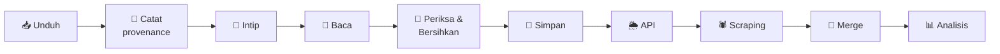

<div align="center">

# 🌴 Bali Tourism Intelligence

### Kunjungan Wisatawan Domestik Bulanan × Cuaca Bali (2004–2025)

*Pipeline akuisisi data yang etis, terdokumentasi, dan dapat direproduksi: dari berkas statistik, API, hingga web scraping.*


**UTS Data Acquisition & Management · INSTIKI**

</div>

---

## 📌 Ringkasan

Proyek ini membangun **pipeline akuisisi data end-to-end** untuk menjawab satu pertanyaan sederhana namun menarik:

> **Apakah cuaca di Bali (suhu, hujan, angin) berkaitan dengan naik-turunnya kunjungan wisatawan domestik?**

Dataset utama berisi **264 observasi** (22 tahun × 12 bulan) kunjungan wisatawan domestik ke Bali pada 2004–2025 dari Dinas Pariwisata Provinsi Bali. Data tersebut digabungkan dengan **cuaca harian historis Denpasar** dari API Open-Meteo, lalu diperkaya dengan data pendukung dari BPS Bali dan hasil *web scraping* listing daya tarik wisata.

Fokus proyek bukan hanya pada hasil analisis, tetapi pada **proses yang bertanggung jawab**: setiap berkas dicatat asal-usulnya (*provenance*), divalidasi, dan diperiksa aspek lisensi, PII, serta etikanya.

---

## ✨ Fitur Utama

| | Fitur | Keterangan |
|---|---|---|
| 🧾 | **Provenance tracking** | URL, waktu akses UTC, lisensi, ukuran, dan checksum MD5 setiap berkas tercatat di `docs/provenance.json` |
| 🔒 | **Raw data immutable** | Berkas mentah tidak pernah ditimpa; integritas diverifikasi ulang lewat MD5 |
| 🧹 | **Parser khusus per tabel** | Tabel statistik dengan header bertingkat, subtotal, dan catatan kaki dibersihkan secara eksplisit |
| ✅ | **Validasi berlapis** | Total vs jumlah komponen, growth rate, dan validasi silang antar-sumber |
| 🌦️ | **Integrasi API** | Cuaca harian 2004–2025 dari Open-Meteo (tanpa API key) |
| 🕷️ | **Scraping etis** | Cek `robots.txt`, `timeout`, jeda antar-request, dan User-Agent berisi email kampus |
| 🔗 | **Merge terbukti aman** | `validate="one_to_one"` + bukti tanpa duplikasi atau ledakan baris |
| 🛡️ | **Data Ethics Checklist** | 9 butir etika dibuat otomatis dari bukti yang benar-benar ada |

---

## 🗺️ Alur Kerja



---

## 🧩 Struktur Notebook

| Soal | Isi | Bab |
|:---:|---|:---:|
| **1** | Baca berkas (5 CSV + Tabel 6, 7, 17, 28), identifikasi dataset, estimasi storage | BAB 1–2 |
| **2** | Lisensi/ToS, deteksi PII, Data Ethics Checklist | BAB 3 |
| **3** | Akuisisi via API (Open-Meteo, opsional BPS Web API) | BAB 4 |
| **4** | Pemeriksaan `robots.txt` dan web scraping | BAB 5 |
| **5** | Merge, bukti tanpa duplikasi, analisis asosiasi, penyimpanan | BAB 6 |
| – | Verifikasi MD5, checklist final, ringkasan | BAB 7 |

---

## 📦 Sumber Data

### Berkas (diunduh manual)

| Kode | Dataset | Periode | Sumber |
|:---:|---|:---:|---|
| **D1** ⭐ | Wisatawan domestik bulanan ke Bali **(dataset utama)** | 2004–2025 | Survei Dinas Pariwisata Prov. Bali |
| D2 | Wisman ke Indonesia & Bali (tahunan) | 1969–2025 | BPS Provinsi Bali |
| D3 | Wisman bulanan menurut pintu masuk | 2025 | BPS Provinsi Bali |
| D4 | TPK hotel bintang menurut kelas | 2025 | BPS Provinsi Bali |
| D5 | Wisman langsung ke Bali menurut kebangsaan | 2019–2024 | BPS Provinsi Bali |
| Tabel 6 | 20 negara pasar utama wisman | 2024–2025 | Buku Statistik Pariwisata Bali 2025 |
| Tabel 7 | Kedatangan wisman per kebangsaan per bulan | 2025 | Buku Statistik Pariwisata Bali 2025 |
| Tabel 17 | Kunjungan ke obyek & daya tarik wisata (ODTW) | 2016–2025 | Buku Statistik Pariwisata Bali 2025 |
| Tabel 28 | Perkembangan kepariwisataan Bali | 2019–2025 | Buku Statistik Pariwisata Bali 2025 |

### API & Web

| Metode | Sumber | Data |
|---|---|---|
| 🌦️ API | [Open-Meteo Historical Weather API](https://open-meteo.com/en/docs/historical-weather-api) | Suhu rata-rata, curah hujan, angin maksimum harian Denpasar |
| 🏛️ API *(opsional)* | [BPS Web API](https://webapi.bps.go.id/documentation/) | Dilewati otomatis bila key/`VAR_ID` belum ada |
| 🕷️ Scraping | [Disparda Bali](https://disparda.baliprov.go.id) | Listing daya tarik wisata per kabupaten/kota |

---

## 🔍 Validasi Data

Data dianggap layak hanya setelah lolos pemeriksaan berikut:

- **Struktur dataset utama**: tepat 12 bulan per tahun, tanpa duplikasi `(tahun, bulan)`, tanpa nilai kosong, dan minimal 100 baris.
- **Total & growth**: jumlah 12 bulan sama dengan baris `BALI`; growth yang dihitung ulang cocok dengan yang tertulis di sumber.
- **Subtotal hierarkis**: jumlah negara = subtotal kelompok; jumlah subtotal = total (Tabel 6, 7, 17, D5).
- **Validasi silang antar-sumber**: angka kedatangan wisman yang sama muncul di D2, D3, D5, Tabel 6, 7, dan 28, lalu dibandingkan satu sama lain.
- **Selisih di sumber dicatat apa adanya**, tidak dikoreksi diam-diam. Transparansi lebih penting daripada angka yang tampak mulus.

---

## 📈 Analisis

Setelah di-*merge* (`wisnus` × cuaca bulanan), asosiasi diuji dengan **korelasi Spearman** pada tiga skenario:

| Skenario | Tujuan |
|---|---|
| **A.** Semua bulan (kunjungan) | Gambaran kasar |
| **B.** Tahun normal (kunjungan) | Mengeluarkan 2020–2022 yang terdistorsi pandemi |
| **C.** Tahun normal (**indeks musiman**) | Paling bersih dari tren tahunan dan efek pandemi |

> **Indeks musiman** = kunjungan bulan ÷ rata-rata bulanan pada tahun yang sama, sehingga tren jangka panjang tidak mengaburkan pola musiman.

⚠️ **Hasil hanya menunjukkan asosiasi, bukan sebab-akibat.** Musim kemarau, libur sekolah, dan faktor lain dapat mengaitkan cuaca dengan kunjungan.

Visualisasi yang dihasilkan (`docs/gambar/`):
- `kunjungan_wisnus_bulanan.png`: deret waktu 2004–2025 dengan penanda periode pandemi
- `hujan_vs_indeks_musiman.png`: sebaran hujan bulanan vs indeks musiman

---

## 📁 Struktur Repositori

```text
UTS_DATAAKUISISI_pariwisata_<NIM>/
├── UTS_DAM.ipynb                  # notebook utama (jalankan dari atas ke bawah)
├── README.md
├── data/
│   ├── raw/                       # berkas mentah (TIDAK diubah)
│   │   └── bukti_kepatuhan/       # robots.txt & halaman lisensi/ToS sebagai bukti
│   ├── interim/                   # hasil antara (cuaca harian/bulanan, scraping, audit sheet)
│   └── processed/                 # hasil akhir bersih
│       ├── bali_wisnus_cuaca_bulanan.csv    # ⭐ dataset gabungan final
│       ├── metadata_hasil_gabungan.json
│       └── asosiasi_spearman.csv
└── docs/
    ├── provenance.json            # asal-usul setiap berkas (URL, UTC, lisensi, MD5)
    ├── data_ethics_checklist.md   # checklist etika 9 butir
    ├── data_dictionary_gabungan.csv
    ├── identifikasi_gabungan_tabel.csv
    ├── rincian_storage_sumber.csv
    ├── bukti_lisensi_tos.csv
    ├── bukti_robots.csv
    ├── pii_scan_semua_sheet.csv
    └── gambar/
```

---

## 🚀 Cara Menjalankan

### Opsi 1: Google Colab (disarankan)

1. Unggah notebook ke Google Colab.
2. Buka **SEL 2** dan isi konfigurasi:
   ```python
   EMAIL_KAMPUS = "emailkamu@instiki.ac.id"       # masuk ke User-Agent
   NIM_FOLDER   = "UTS_DATAAKUISISI_pariwisata_<NIM>"
   URL_CSV_SUMBER = "https://..."                  # URL portal sumber CSV
   ```
3. Jalankan **Runtime → Run all**. Google Drive akan di-*mount* otomatis.
4. Saat diminta, unggah berkas mentah yang belum ada di `data/raw`.
5. Isi `HASIL_CEK_LISENSI`, `TOS_DIBACA_MANUAL`, `RENCANA_DIKONFIRMASI` di **SEL 17**, lalu jalankan ulang **SEL 17** dan **SEL 30**.

### Opsi 2: Lokal

```bash
git clone https://github.com/<username>/<nama-repo>.git
cd <nama-repo>

pip install pandas numpy requests beautifulsoup4 lxml openpyxl xlrd scipy matplotlib jupyter

# Letakkan berkas mentah di data/raw/, lalu:
jupyter notebook
```

> Di luar Colab, notebook menggunakan folder `./<NIM_FOLDER>` di direktori kerja dan tidak meminta unggahan; letakkan semua berkas mentah di `data/raw/` terlebih dahulu.

### 🔑 API Key (opsional)

BPS Web API membutuhkan key. **Jangan menuliskannya di notebook.** Simpan di **Colab Secrets** dengan nama `BPS_API_KEY`, atau sebagai environment variable. Tanpa key, sel BPS dilewati otomatis. Open-Meteo sudah cukup untuk memenuhi syarat API dan tidak butuh key.

---

## ⚖️ Etika & Kepatuhan

Proyek ini mengikuti prinsip akuisisi data yang bertanggung jawab:

- ✅ **User-Agent jujur**: identitas dan email kampus selalu dicantumkan
- ✅ **Timeout & retry terkontrol**: `timeout=(5, 30)`, retry dengan *backoff* untuk 429/5xx
- ✅ **Jeda antar-request**: 2 detik, menghormati server sumber
- ✅ **`robots.txt` diperiksa** sebelum scraping, dengan bukti tersimpan (`docs/bukti_robots.csv`)
- ✅ **Tidak ada PII**: seluruh sheet dan CSV dipindai (email, telepon, kata kunci header); data bersifat agregat tingkat provinsi
- ✅ **Data minimization**: hanya tabel dan variabel yang relevan yang diproses
- ✅ **API key disamarkan** dari log dan provenance
- ✅ **Lisensi tidak diasumsikan**: status sumber ditulis jujur sebagai *Needs verification* bila belum terkonfirmasi

> `robots.txt` bukan izin otomatis. Ketentuan penggunaan situs (ToS) tetap dibaca manual dan dicatat di checklist.

---

## ⚠️ Keterbatasan

- **Wisnus berasal dari survei**, bukan sensus, sehingga mengandung galat sampling.
- **Cuaca hanya satu titik (Denpasar)**, belum mewakili seluruh Bali.
- **2020–2022 anomali pandemi**, sehingga dipisahkan dalam analisis.
- **Wisman** hanya yang datang langsung melalui pintu masuk Bali.
- **Tabel 7** bertanda data sementara; **Tabel 17** hanya mencakup ODTW yang tercatat, dan 2016–2017 tidak dipisah wisnus/wisman.
- **Selisih angka di berkas sumber** (mis. nilai Bandara bulan Juni pada data pintu masuk) dicatat apa adanya dan tidak dikoreksi.
- Korelasi **tidak** menyiratkan kausalitas.

---

## 🛠️ Tech Stack

`Python` · `pandas` · `NumPy` · `requests` · `BeautifulSoup4` · `lxml` · `openpyxl` / `xlrd` · `SciPy` · `Matplotlib`

---

## 📜 Lisensi & Atribusi

- **Kode** dalam repositori ini: tentukan lisensi sesuai kebutuhan (mis. MIT).
- **Data sumber**: hak cipta tetap pada pemilik asli (Dinas Pariwisata Provinsi Bali dan BPS Provinsi Bali). Status lisensi masing-masing berkas tercatat di `docs/provenance.json`; sebagian masih *Needs verification*.
- **Data cuaca**: [Open-Meteo](https://open-meteo.com/en/license), CC BY 4.0. Atribusi wajib dicantumkan.

Proyek ini dibuat untuk **tujuan akademik** dan tidak untuk penggunaan komersial.

---

## 👤 Penulis

**<Nama Lengkap>** · NIM `2501010376`
Program Studi Informatika, INSTIKI
Mata kuliah: *Data Acquisition & Management*

---

<div align="center">

⭐ Jika proyek ini bermanfaat, jangan ragu memberi bintang!

</div>
